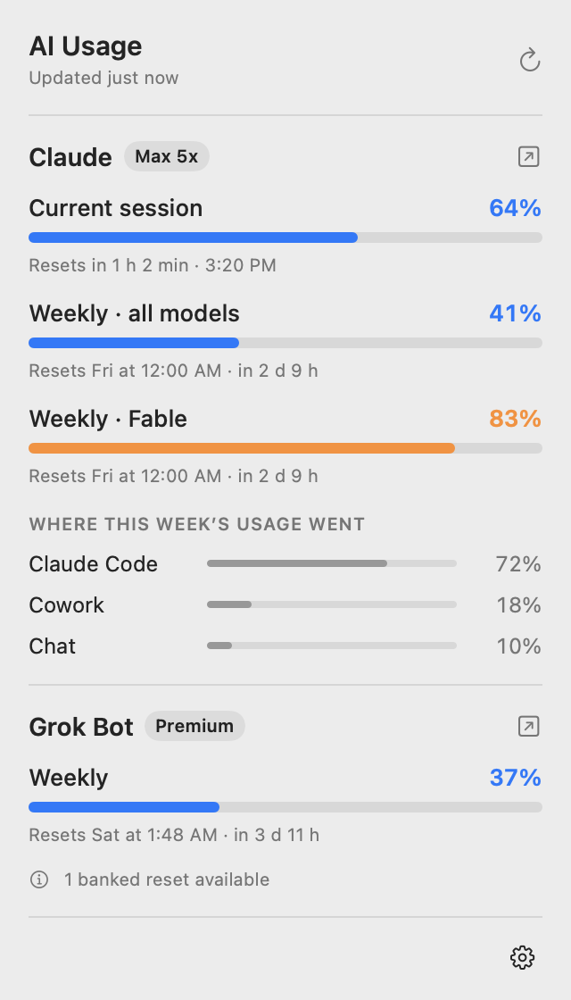
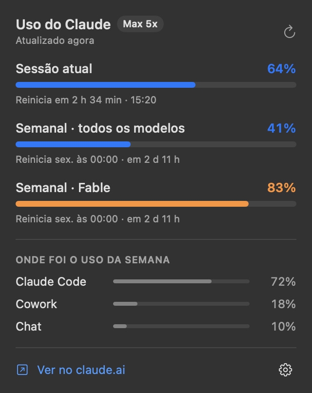
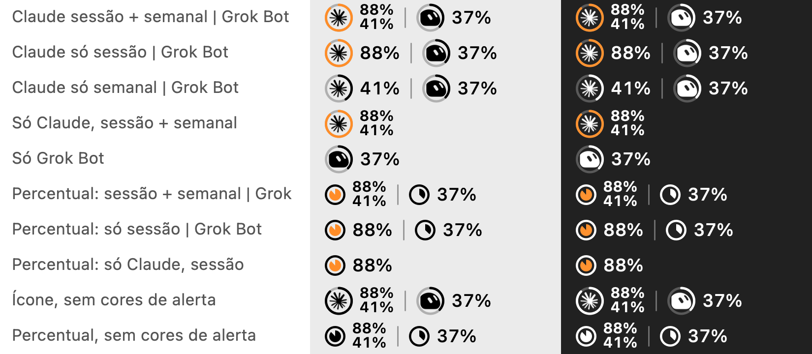
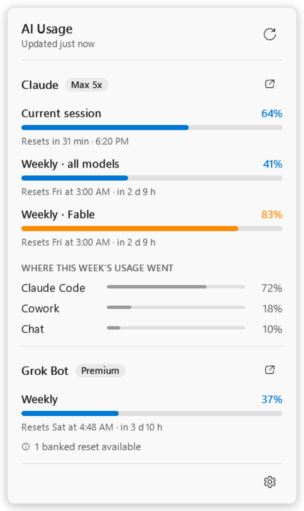

# AI Usage Bar

**English** · [Português](README.pt-BR.md) · **[Website & downloads](https://matheusvelloso.github.io/ai-usage-bar/)**

> **Independent project.** Not affiliated with, sponsored or endorsed by Anthropic, GitHub/Microsoft, xAI/SpaceXAI or Anysphere (Cursor). Claude, GitHub Copilot, Grok and Grok Bot are trademarks of their respective owners. The app relies on internal, undocumented endpoints of these services, which may change or stop working at any time. Use at your own risk.

A meter for your AI usage limits that lives in the macOS menu bar or the Windows tray. Each AI shows up as a minimal icon (Claude's star, Grok Bot's little character) inside a ring that fills with usage; one click opens a popover with the details for each service. With two or more AIs connected, the popover has **one tab per agent**, each showing its fullest limit so you can see them all at a glance:

**Claude**
- **Current session** (5-hour window): how much is used and when it resets
- **Weekly, all models**
- **Weekly per model** (e.g. Fable), when your plan has a separate limit for it
- **Where this week's usage went**: Claude Code, Chat, Cowork…

**GitHub Copilot**
- **Premium requests** for the month: how much is used and when the allowance resets
- Chat and code completions on plans where they are limited (e.g. Copilot Free)

**Grok Bot**
- **Weekly**: how much is used and when it resets
- Banked resets and on-demand usage, when present

The numbers are the same ones shown in claude.ai → Settings → Usage, in Claude Code's `/usage`, in GitHub's Copilot settings and in Grok Bot's own Usage screen. Copilot and Grok Bot only appear if they are signed in on this computer.

### Connecting your agents

The **＋** tab (or ⚙ → **Set up agents…**) lists every supported agent: ✓ connected, or a hint on how to sign in (for Copilot: sign in to GitHub Copilot in VS Code, or run `gh auth login`). It opens by itself on the first launch. The app never asks you to log in: it reuses the logins your tools already have, so signing in elsewhere is enough and the tab appears within a few minutes. Untick **Show** to hide an agent you do not want to track.

<p align="center">
  
  
</p>

## Menu bar

Under ⚙︎ in the popover:

**Menu bar style** (applies to every AI)
- **AI icon with ring** (default): each AI's icon inside a ring that fills with usage.
- **Percentage only**: no icon, just a small pie gauge and the number, like the very first version.

**What each AI shows**

| Service | Options |
|---|---|
| Claude | **Current session only** · **Weekly only** · **Session + weekly** (default: session on top, weekly below) · **Hide** |
| GitHub Copilot | **Monthly** (default) · **Hide** |
| Grok Bot | **Weekly** (default) · **Hide** |

Everything is drawn in the menu bar's own color, like other menu bar icons: white on a dark menu bar, black on a light one. The ring (or pie) follows the first number (with "Session + weekly" it shows the session) and is the only element that changes color: orange when usage reaches a warning level and red when it is critical.

**Alert colors in menu bar** (on by default): turn it off to keep the ring or pie in the menu bar color, without orange or red. The popover keeps its colors.

**Language**: English or Português. Applies to the popover, the gear menu, messages and times (AM/PM in English, 24-hour in Portuguese). A fresh install starts in the macOS language.

The icons are the agents' own official artwork, cut out at runtime from what is installed on the computer: the meter keeps only the artwork and drops the colored background, and draws it in the menu bar's or taskbar's color. Claude and Grok Bot come from their apps (on Windows also from Microsoft Store installs); GitHub Copilot comes from GitHub's own VS Code extension (`github.copilot-chat`, also found in VS Code Insiders and Cursor). No brand artwork ships with this repository. If an icon cannot be found, the service's initial is shown instead.

<p align="center">
  
</p>

## Platforms

| System | Status | Where |
|---|---|---|
| macOS 13+ (Apple Silicon and Intel) | ✅ Native app (Swift/SwiftUI), `.dmg` installer | [`macos/`](macos/) |
| Windows 10/11 (x64) | 🧪 New: native app (C#/WPF), installer and portable `.exe`. Built and tested by CI, not yet on a real PC | [`windows/`](windows/) |
| Linux | Planned | — |

Each system gets its own native app and installer. Everything a new port needs is in [`docs/usage-api.md`](docs/usage-api.md): where each login comes from, which endpoints to call and how to read the responses. Use [`docs/sample-usage.json`](docs/sample-usage.json), [`docs/sample-copilot-usage.json`](docs/sample-copilot-usage.json) and [`docs/sample-grok-usage.json`](docs/sample-grok-usage.json) as test data.

## Download

The [website](https://matheusvelloso.github.io/ai-usage-bar/) always links to the latest release:

| System | File |
|---|---|
| macOS | [`AIUsageBar-macOS.dmg`](https://github.com/matheusvelloso/ai-usage-bar/releases/latest/download/AIUsageBar-macOS.dmg) |
| Windows (installer) | [`AIUsageBar-Windows-Setup.exe`](https://github.com/matheusvelloso/ai-usage-bar/releases/latest/download/AIUsageBar-Windows-Setup.exe) |
| Windows (portable) | [`AIUsageBar-Windows-Portable.exe`](https://github.com/matheusvelloso/ai-usage-bar/releases/latest/download/AIUsageBar-Windows-Portable.exe) |

## Install on a Mac

1. Open `AIUsageBar-<version>.dmg` and drag **AI Usage Bar** into **Applications**.
2. The first time, right-click the app → **Open**. The app is not signed with an Apple certificate yet, so macOS asks for this confirmation once.
3. If you use Grok Bot, macOS asks whether the app may access **"Grok Bot Safe Storage"** in the Keychain. Choose **Always Allow** (see [How it works](#how-it-works)).
4. To start with your Mac: ⚙︎ in the popover → **Open at login**.

**Requirements:** Claude Code signed in on this Mac (through the Claude app or the `claude` command). For GitHub Copilot, a Copilot plan and a signed-in editor plugin (VS Code, JetBrains) or the `gh` CLI. For Grok Bot, the Grok Bot app installed and signed in.

## Install on Windows

1. Run `AIUsageBar-Windows-Setup.exe` (installs for your user only, no admin rights). If SmartScreen appears, click **More info** → **Run anyway**: the app is not signed with a Microsoft certificate yet.
2. Each AI gets its own **tray icon**, next to the clock. Windows may put new icons in the **^** overflow area; drag them onto the taskbar to keep them visible.
3. Left-click an icon for the popup, right-click for refresh and quit. Options (style, what each AI shows, alert colors, language, start with Windows) are under ⚙ in the popup.

<p align="center"></p>

Windows tray icons are small squares, so each one shows a single value (session *or* weekly) around the AI's icon or as a number; the popup shows everything. Prefer not to install? `AIUsageBar-Windows-Portable.exe` runs as is.

### Taskbar widget (Windows, optional)

For a summary you can see without opening anything, turn on **⚙ → Taskbar widget → Show on the taskbar**. A small pill appears on the taskbar with one chip per agent: its official icon inside a progress ring that follows usage, plus the percentage, coloured orange or red when a limit is close.

- **Hover** a chip for a card with that agent's plan, every limit and when it resets. **Click** opens the full popup on that agent's tab, **drag** moves it, **right-click** has refresh, position, style and hide.
- **Position:** *left of the system tray* (default) or *left edge*, which uses the first free gap from the left (after Widgets on a centred taskbar, so it does not sit on Start or your apps). Drag to fine-tune; "Reset position" undoes it.
- **Style:** icon with ring and percentage, or just the ringed icon.
- It is independent of the tray icons: you can hide those and keep the widget.

Windows 11 has no supported way to add content to the taskbar, so the widget is a small borderless window kept above it. It hides by itself for full-screen apps, games and presentations and while an auto-hidden taskbar is hidden, follows the taskbar across DPI and monitor changes (the primary taskbar only), and is not shown on a vertical taskbar. If you click the taskbar itself, the widget can disappear behind it for up to a second before it comes back.

## Build

### macOS

Requires Xcode (or the Command Line Tools) with Swift 5.10 or newer.

```bash
cd macos
make test      # data layer tests
make build     # creates dist/AI Usage Bar.app and dist/AIUsageBar-<version>.dmg
make install   # copies the app to /Applications and opens it
```

The version comes from `macos/VERSION`. To sign with a Developer ID certificate, run `SIGN_IDENTITY="Developer ID Application: …" make build`.

### Windows

Requires the .NET 10 SDK. The app only runs on Windows, but everything builds (and the core tests run) on macOS and Linux too.

```bash
cd windows
dotnet test tests/UsageCore.Tests     # core tests (any OS)
dotnet run --project tools/Preview -- tray.png --claude-fixture ../docs/sample-usage.json --grok-fixture ../docs/sample-grok-usage.json
dotnet publish src/AIUsageBar -c Release -r win-x64 --self-contained -p:PublishSingleFile=true -p:IncludeNativeLibrariesForSelfExtract=true -o publish/win-x64
```

The installer is made with [Inno Setup](https://jrsoftware.org/isinfo.php) from `windows/installer/AIUsageBar.iss` (see `.github/workflows/windows.yml`).

## How it works

Each service is a provider (`UsageProvider`) that reads the login of an app that is already installed and calls the same endpoint that app uses for its own usage screen. It refreshes every 3 minutes, when the popover opens and when the Mac wakes up. The last response is cached so something shows up as soon as the app starts.

| Service | Login reused | Endpoint |
|---|---|---|
| Claude | Keychain item `Claude Code-credentials`, read through `/usr/bin/security` | `GET api.anthropic.com/api/oauth/usage` |
| GitHub Copilot | The token the Copilot editor plugin keeps in `~/.config/github-copilot/apps.json` (or `hosts.json`), then `GH_TOKEN` / `GITHUB_TOKEN`, then `gh auth token` | `GET api.github.com/copilot_internal/user` |
| Grok Bot | `~/Library/Application Support/Grok Bot/sand-secrets.json`, encrypted by Electron with the key in the **Grok Bot Safe Storage** Keychain item | `POST api2.cursor.sh/aiserver.v1.DashboardService/GetSandUsageStatus` |

On Windows the same endpoints are used; Claude Code's login is read from `%USERPROFILE%\.claude\.credentials.json`, Copilot's from `%LOCALAPPDATA%\github-copilot\apps.json` and Grok Bot's from `%APPDATA%\Grok Bot\sand-secrets.json`, whose key Electron protects with DPAPI in `Local State`. These Windows locations follow how the apps work elsewhere but have not been checked on a real PC yet.

Tokens are **read only**, in memory: the app never writes, refreshes or sends a token anywhere other than the service it belongs to. The cache holds usage responses only.

## Limitations

- **The endpoints are not public.** They are the ones Claude Code and Grok Bot use themselves and may change without notice. The app ignores unknown fields; if the format changes completely, it says it needs an update.
- **The Copilot endpoint is unofficial and not yet verified against a real account.** `copilot_internal/user` is what GitHub's own editor plugins call; its fields are known from third-party tools, not from GitHub's documentation. Not every kind of GitHub token is accepted by it (the editor plugin's token is the safest). Organization-managed seats may report no premium allowance.
- **Logins expire.** Claude Code and Grok Bot refresh their own tokens when used. If one of them sits idle for hours, the meter shows the last value and asks you to open that app once.
- **Grok Bot and the Keychain:** macOS grants the Grok Bot key to *this build* of the app. Because the app is only signed locally (ad-hoc), each new version asks for "Always Allow" again. A Developer ID certificate removes that.
- **Not signed by Apple or Microsoft yet**, hence the right-click → Open step on macOS and the SmartScreen prompt on Windows.
- **Windows is new.** CI builds it, runs its tests and renders its popup from sample data, but it has not run on a real PC with real logins yet. Reports are welcome.

## Debugging

macOS:

```bash
APP="/Applications/AI Usage Bar.app/Contents/MacOS/AIUsageBar"
"$APP" --dump                 # prints current usage as text
"$APP" --dump --raw           # … plus the raw responses (no tokens)
"$APP" --snapshot pop.png     # renders the popover, and every menu bar combination to pop-menubar.png
"$APP" --snapshot pop.png --fixture docs/sample-usage.json --copilot-fixture docs/sample-copilot-usage.json --grok-fixture docs/sample-grok-usage.json --dark --lang en
"$APP" --snapshot pop.png --fixture docs/sample-usage.json --copilot-fixture docs/sample-copilot-usage.json --tab copilot   # a given tab
"$APP" --snapshot pop.png --fixture docs/sample-usage.json --first-run                                                   # the first-run Agents tab
```

Windows (it is a GUI app, so use `Start-Process -Wait` to see the output):

```powershell
Start-Process AIUsageBar.exe -ArgumentList '--dump' -Wait -NoNewWindow
Start-Process AIUsageBar.exe -ArgumentList '--snapshot','pop.png','--fixture','docs\sample-usage.json' -Wait   # also writes pop-tray.png
# add '--copilot-fixture','docs\sample-copilot-usage.json', '--tab','copilot' or '--first-run' to render other states
Start-Process AIUsageBar.exe -ArgumentList '--widget-demo','--fixture','docs\sample-usage.json','--copilot-fixture','docs\sample-copilot-usage.json'   # real tray + taskbar widget on sample data (no logins, no network); add --left-edge, --ring-only, --dark
```

## Layout

```
docs/
  usage-api.md            data contract for every port
  sample-usage.json       sample Claude response (made-up numbers)
  sample-copilot-usage.json  sample Copilot response (made-up numbers; field names from third-party tools)
  sample-grok-usage.json  sample Grok Bot response (made-up numbers)
macos/
  Sources/UsageCore/      providers (Claude, Copilot, Grok Bot), logins, HTTP clients, tab logic, EN/PT strings (tested)
  Sources/AIUsageBar/     menu bar item (AppKit) + popover (SwiftUI)
  Tests/                  data layer tests
  Support/                Info.plist and app icon
  scripts/                .app/.dmg build and icon generation
windows/
  src/UsageCore/          providers, logins (DPAPI), tray icon drawing; cross-platform (tested)
  src/AIUsageBar/         tray icons (WinForms NotifyIcon) + popup (WPF)
  tests/                  core tests
  tools/Preview/          renders every tray icon combination to a PNG, on any OS
  installer/              Inno Setup script
docs/index.html           website (GitHub Pages) with download links
.github/workflows/        macOS and Windows builds, tests and releases
```

## License

[MIT](LICENSE).
