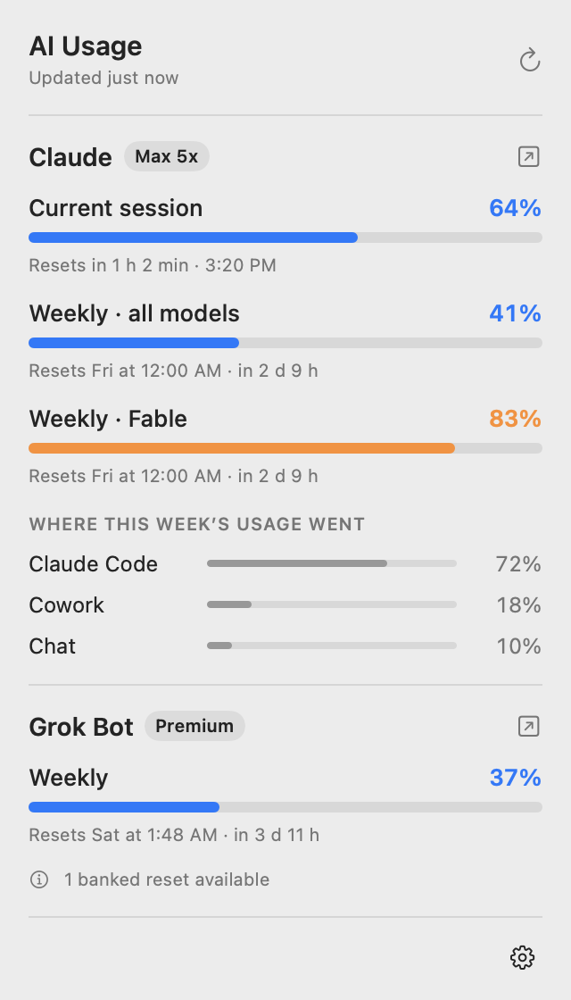
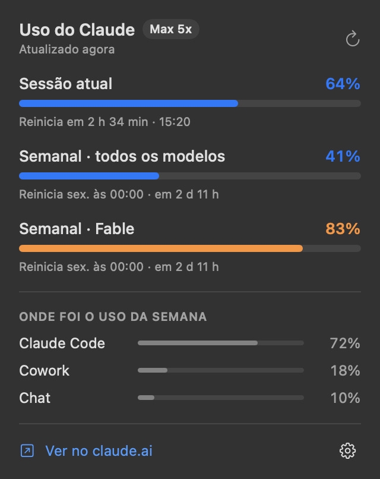
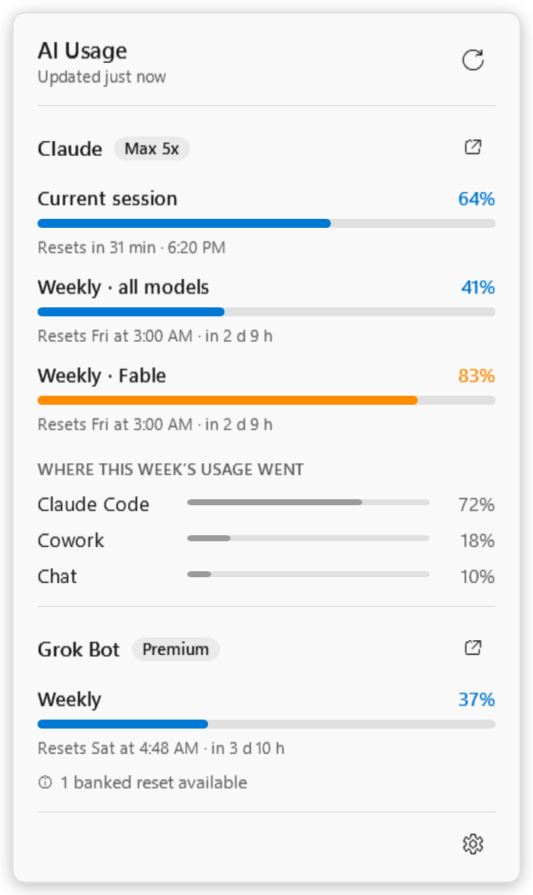
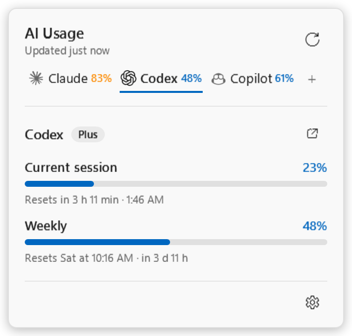
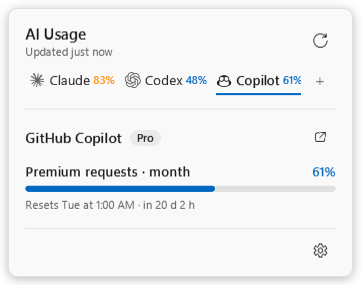
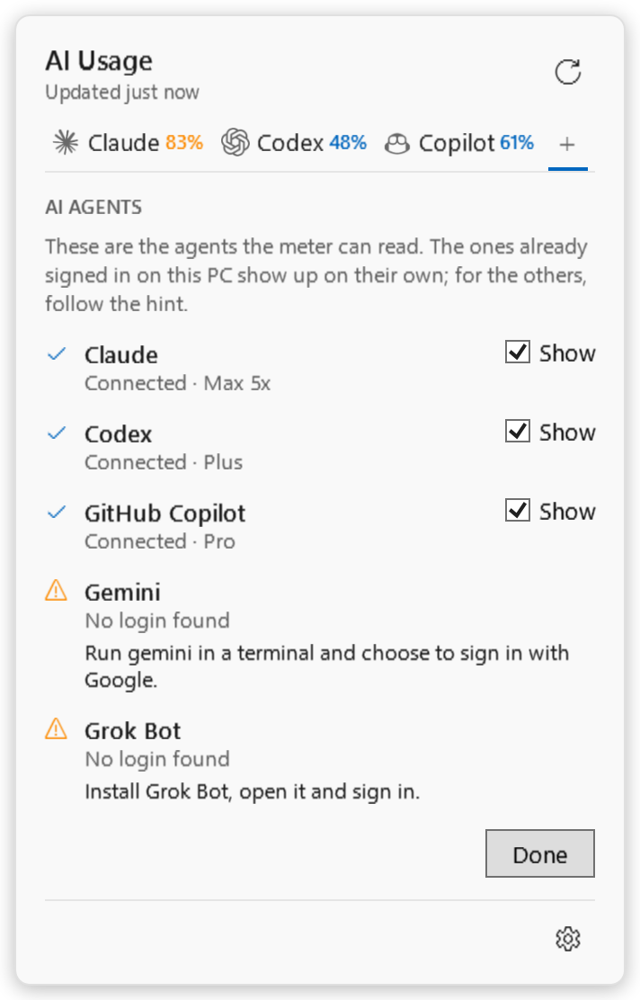
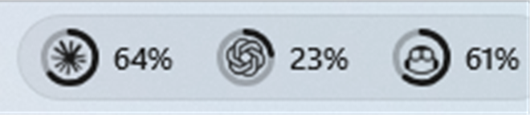
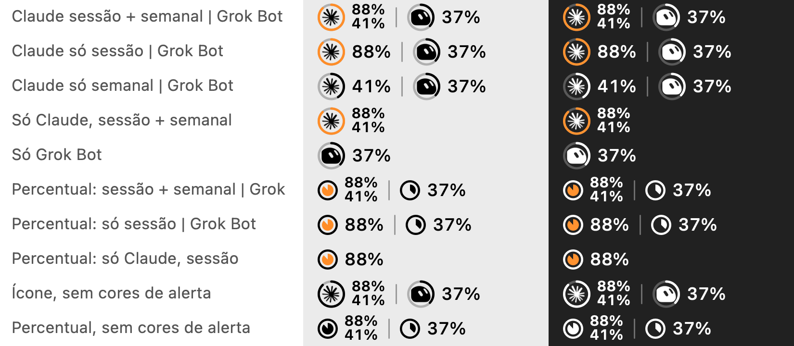

# AI Usage Bar

[English](README.md) · **Português** · **[Site e downloads](https://matheusvelloso.github.io/ai-usage-bar/)**

> **Projeto independente.** Não é afiliado, patrocinado nem endossado pela Anthropic, pela OpenAI, pelo GitHub/Microsoft, pelo Google, pela xAI/SpaceXAI ou pela Anysphere (Cursor). Claude, Codex, GitHub Copilot, Gemini, Grok e Grok Bot são marcas dos seus respectivos donos. O app usa endpoints internos e não documentados desses serviços, que podem mudar ou deixar de funcionar a qualquer momento. Use por sua conta e risco.

Um medidor do seu limite de uso de IA que fica na barra de menu do macOS ou na bandeja do Windows. Cada IA aparece com o próprio ícone oficial (a estrelinha do Claude, a flor do Codex, o mascote do Copilot…) dentro de um anel que se preenche com o uso; um clique abre o pop-up com os detalhes de cada serviço. Com duas ou mais IAs conectadas, o pop-up ganha **uma aba por agente**, cada uma mostrando o limite mais cheio, para você ver tudo de relance:

**Claude**
- **Sessão atual** (janela de 5 h): quanto já foi usado e quando reinicia
- **Semanal, todos os modelos**
- **Semanal por modelo** (ex.: Fable), quando o seu plano tem esse limite separado
- **Onde foi o uso da semana**: Claude Code, Chat, Cowork…

**Codex** (OpenAI)
- **Sessão atual** (janela de 5 h) e **Semanal**: quanto já foi usado e quando cada uma reinicia

**GitHub Copilot**
- **Requisições premium** do mês: quanto já foi usado e quando a cota reinicia
- Chat e completações de código nos planos em que são limitados (ex.: Copilot Free)

**Gemini** (Gemini CLI)
- Cota **Diária** por modelo (2.5 Pro primeiro, depois Flash e Flash-Lite): quanto já foi usado e quando reinicia

**Grok Bot**
- **Semanal**: quanto já foi usado e quando reinicia
- Resets guardados disponíveis e uso sob demanda, quando houver

Os números são os mesmos de claude.ai → Configurações → Uso, do `/usage` do Claude Code, da página de uso do Codex no ChatGPT, das configurações do Copilot no GitHub, das cotas que o Gemini CLI informa e da tela de Uso do Grok Bot. O Codex, o Copilot, o Gemini e o Grok Bot só aparecem se estiverem logados neste computador.

### Conectando seus agentes

A aba **＋** (ou ⚙ → **Configurar agentes…**) lista todos os agentes compatíveis: ✓ conectado, ou uma dica de como entrar (no Copilot: entre no GitHub Copilot no VS Code ou rode `gh auth login`; no Codex: `codex login`; no Gemini: rode `gemini` e entre com o Google). Ela abre sozinha na primeira vez que o app é iniciado. O app nunca pede login: ele reaproveita os logins que suas ferramentas já têm, então basta entrar em outro lugar e a aba aparece em poucos minutos. Desmarque **Mostrar** para esconder um agente que você não quer acompanhar.

<p align="center">
  
  
</p>

### Capturas de tela (Windows)

Uma aba por agente, cada uma com o ícone oficial do agente e o limite mais cheio; a aba **＋** lista todos os agentes compatíveis e como conectar os que ainda não estão logados.

<p align="center">
  
  
  
</p>
<p align="center">
  
</p>

O [widget na barra de tarefas](#widget-na-barra-de-tarefas-windows-opcional) opcional, numa barra de tarefas do Windows 11:

<p align="center"></p>

*As capturas do Windows são feitas com dados de exemplo no app de verdade (a opção `--snapshot`, e uma captura da barra de tarefas para o widget). Elas mostram os agentes cujos ícones estavam instalados no computador que as gerou; um agente sem fonte de ícone instalada mostra a inicial. As imagens do macOS acima são anteriores ao Codex, ao Copilot e ao Gemini.*

## Barra de menu

Em ⚙︎ no pop-up:

**Estilo na barra** (vale para todas as IAs)
- **Ícone da IA com anel** (padrão): o ícone de cada IA dentro de um anel que se preenche com o uso.
- **Só o percentual**: sem ícone, só uma bolinha em pizza que se preenche e o número, como na primeira versão.

**O que cada IA mostra**

| Serviço | Opções |
|---|---|
| Claude | **Só a sessão atual** · **Só a semanal** · **Sessão atual + semanal** (padrão: sessão em cima, semanal embaixo) · **Não mostrar** |
| Codex | **Só a sessão atual** · **Só a semanal** · **Sessão atual + semanal** (padrão) · **Não mostrar** |
| GitHub Copilot | **Mensal** (padrão) · **Não mostrar** |
| Gemini | **Diário** (padrão, a cota do modelo Pro) · **Não mostrar** |
| Grok Bot | **Semanal** (padrão) · **Não mostrar** |

Tudo é desenhado na cor da barra, como os outros ícones: branco na barra escura e preto na clara. O anel (ou a pizza) acompanha o primeiro número (com "Sessão atual + semanal", ele mostra a sessão) e é o único elemento que muda de cor: fica laranja quando o uso entra em alerta e vermelho quando está crítico.

**Cores de alerta na barra** (ligado por padrão): desligue para o anel ou a pizza ficarem sempre na cor da barra, sem o laranja e o vermelho. O pop-up continua mostrando as cores.

**Idioma**: Português ou English. Vale para o pop-up, a engrenagem, os avisos e os horários (24 h em português, AM/PM em inglês). Numa instalação nova, o app começa no idioma do macOS.

Os ícones são a arte oficial de cada IA, extraída na hora do que está instalado no computador: o medidor mantém só a arte e descarta o fundo colorido, e a desenha na cor da barra de menu ou da barra de tarefas. O Claude e o Grok Bot vêm dos próprios apps (no Windows, também de instalações pela Microsoft Store); o GitHub Copilot, o Codex e o Gemini vivem em editores, então os ícones deles vêm das extensões oficiais para editor (`github.copilot-chat`, a extensão do Codex da OpenAI `openai.chatgpt` e a `google.geminicodeassist` do Google; também presentes no VS Code Insiders e no Cursor). Nenhuma imagem de marca vem no repositório. Se um ícone não for encontrado, aparece a inicial do serviço.

<p align="center">
  
</p>

## Plataformas

| Sistema | Situação | Onde |
|---|---|---|
| macOS 13+ (Apple Silicon e Intel) | ✅ App nativo (Swift/SwiftUI), instalador `.dmg` | [`macos/`](macos/) |
| Windows 10/11 (x64) | 🧪 Novo: app nativo (C#/WPF), instalador e `.exe` portátil. Compilado e testado pelo CI, ainda não num PC de verdade | [`windows/`](windows/) |
| Linux | Planejado | — |

Cada sistema tem um app nativo e um instalador próprios. Tudo de que um novo port precisa está em [`docs/usage-api.md`](docs/usage-api.md): de onde vem cada login, quais endpoints chamar e como ler as respostas. Use [`docs/sample-usage.json`](docs/sample-usage.json), [`docs/sample-codex-usage.json`](docs/sample-codex-usage.json), [`docs/sample-copilot-usage.json`](docs/sample-copilot-usage.json), [`docs/sample-gemini-usage.json`](docs/sample-gemini-usage.json) e [`docs/sample-grok-usage.json`](docs/sample-grok-usage.json) como dados de teste.

## Baixar

O [site](https://matheusvelloso.github.io/ai-usage-bar/) sempre aponta para a versão mais recente:

| Sistema | Arquivo |
|---|---|
| macOS | [`AIUsageBar-macOS.dmg`](https://github.com/matheusvelloso/ai-usage-bar/releases/latest/download/AIUsageBar-macOS.dmg) |
| Windows (instalador) | [`AIUsageBar-Windows-Setup.exe`](https://github.com/matheusvelloso/ai-usage-bar/releases/latest/download/AIUsageBar-Windows-Setup.exe) |
| Windows (portátil) | [`AIUsageBar-Windows-Portable.exe`](https://github.com/matheusvelloso/ai-usage-bar/releases/latest/download/AIUsageBar-Windows-Portable.exe) |

## Instalar no Mac

1. Abra o `AIUsageBar-<versão>.dmg` e arraste **AI Usage Bar** para **Aplicativos**.
2. Na primeira vez, clique com o botão direito no app → **Abrir**. O app ainda não é assinado com um certificado da Apple, então o macOS pede essa confirmação uma vez.
3. Se você usa o Grok Bot, o macOS pergunta se o app pode acessar **"Grok Bot Safe Storage"** no Keychain. Escolha **Permitir sempre** (veja [Como funciona](#como-funciona)).
4. Para abrir junto com o Mac: ⚙︎ no pop-up → **Abrir ao iniciar o Mac**.

**Requisitos:** o Claude Code logado neste Mac (pelo app do Claude ou pelo `claude` no terminal). Para o Codex, o Codex CLI ou a extensão logado com o ChatGPT (`codex login`). Para o GitHub Copilot, um plano do Copilot e um plugin de editor logado (VS Code, JetBrains) ou o `gh` CLI. Para o Gemini, o Gemini CLI logado com o Google (`gemini`). Para o Grok Bot, o app Grok Bot instalado e logado.

## Instalar no Windows

1. Rode o `AIUsageBar-Windows-Setup.exe` (instala só para o seu usuário, sem administrador). Se o SmartScreen aparecer, clique em **Mais informações** → **Executar assim mesmo**: o app ainda não tem certificado da Microsoft.
2. Cada IA ganha o **próprio ícone na bandeja**, perto do relógio. O Windows pode colocar ícones novos na área escondida (**^**); arraste-os para a barra de tarefas para deixá-los visíveis.
3. Clique com o botão esquerdo para abrir o pop-up e com o direito para atualizar ou sair. As opções (estilo, o que cada IA mostra, cores de alerta, idioma, abrir com o Windows) ficam em ⚙ no pop-up.

<p align="center"></p>

Os ícones da bandeja do Windows são quadradinhos, então cada um mostra um valor só (sessão *ou* semanal), em volta do ícone da IA ou como número; o pop-up mostra tudo. Prefere não instalar? O `AIUsageBar-Windows-Portable.exe` roda direto.

### Widget na barra de tarefas (Windows, opcional)

Para ver um resumo sem abrir nada, ligue em **⚙ → Widget na barra de tarefas → Mostrar na barra de tarefas**. Uma pílula pequena aparece na barra de tarefas com um chip por agente: o ícone oficial dele dentro de um anel que acompanha o uso, mais o percentual, em laranja ou vermelho quando um limite está perto.

- **Passe o mouse** sobre um chip para ver um cartão com o plano do agente, cada limite e quando ele reinicia. **Clicar** abre o pop-up completo na aba daquele agente, **arrastar** move o widget e **clicar com o botão direito** tem atualizar, posição, estilo e ocultar.
- **Posição:** *À esquerda da bandeja do sistema* (padrão) ou *Na borda esquerda, junto do Iniciar e da Pesquisa*, que usa o primeiro espaço livre a partir da esquerda (depois de Widgets numa barra centralizada, para não ficar sobre o Iniciar nem sobre os seus apps). Arraste para ajustar; **Restaurar posição** desfaz.
- **Estilo:** *Ícone com anel e percentual* ou *Só o ícone com anel*.
- Ele é independente dos ícones da bandeja: dá para ocultá-los e ficar só com o widget. Para tirá-lo da barra, use **Ocultar da barra de tarefas**.

O Windows 11 não tem uma forma oficial de adicionar conteúdo à barra de tarefas, então o widget é uma janela pequena, sem borda, mantida por cima dela. Ele se esconde sozinho em apps em tela cheia, jogos e apresentações e enquanto uma barra de tarefas com ocultação automática estiver escondida, acompanha a barra de tarefas em mudanças de DPI e de monitor (só a barra principal) e não aparece numa barra de tarefas vertical. Se você clicar na própria barra de tarefas, o widget pode sumir atrás dela por até um segundo antes de voltar.

## Compilar

### macOS

Precisa do Xcode (ou das Command Line Tools) com Swift 5.10 ou mais novo.

```bash
cd macos
make test      # testes da camada de dados
make build     # gera dist/AI Usage Bar.app e dist/AIUsageBar-<versão>.dmg
make install   # copia para /Applications e abre
```

A versão sai do arquivo `macos/VERSION`. Para assinar com um certificado Developer ID, use `SIGN_IDENTITY="Developer ID Application: …" make build`.

### Windows

Precisa do .NET 10 SDK. O app só roda no Windows, mas tudo compila (e os testes do núcleo rodam) também no macOS e no Linux.

```bash
cd windows
dotnet test tests/UsageCore.Tests     # testes do núcleo (qualquer sistema)
dotnet run --project tools/Preview -- tray.png --claude-fixture ../docs/sample-usage.json --grok-fixture ../docs/sample-grok-usage.json
dotnet publish src/AIUsageBar -c Release -r win-x64 --self-contained -p:PublishSingleFile=true -p:IncludeNativeLibrariesForSelfExtract=true -o publish/win-x64
```

O instalador é feito com o [Inno Setup](https://jrsoftware.org/isinfo.php) a partir de `windows/installer/AIUsageBar.iss` (veja `.github/workflows/windows.yml`).

## Como funciona

Cada serviço é um "provedor" (`UsageProvider`) que lê o login de um app já instalado e consulta o mesmo endpoint que esse app usa na própria tela de uso. A consulta acontece a cada 3 minutos, ao abrir o pop-up e quando o Mac acorda. A última resposta fica salva para aparecer na hora em que o app abre.

| Serviço | Login reaproveitado | Endpoint |
|---|---|---|
| Claude | Keychain, item `Claude Code-credentials`, lido via `/usr/bin/security` | `GET api.anthropic.com/api/oauth/usage` |
| Codex | `~/.codex/auth.json` (ou `$CODEX_HOME/auth.json`): o token de acesso do ChatGPT e o id da conta que o Codex CLI e a extensão guardam | `GET chatgpt.com/backend-api/wham/usage` |
| GitHub Copilot | O token que o plugin do Copilot no editor guarda em `~/.config/github-copilot/apps.json` (ou `hosts.json`), depois `GH_TOKEN` / `GITHUB_TOKEN`, depois `gh auth token` | `GET api.github.com/copilot_internal/user` |
| Gemini | `~/.gemini/oauth_creds.json`: o token de acesso do Google que o Gemini CLI guarda | `POST cloudcode-pa.googleapis.com/v1internal:loadCodeAssist`, depois `:retrieveUserQuota` |
| Grok Bot | `~/Library/Application Support/Grok Bot/sand-secrets.json`, criptografado pelo Electron com a chave do item **Grok Bot Safe Storage** do Keychain | `POST api2.cursor.sh/aiserver.v1.DashboardService/GetSandUsageStatus` |

No Windows os endpoints são os mesmos; o login do Claude Code vem de `%USERPROFILE%\.claude\.credentials.json`, o do Codex de `%USERPROFILE%\.codex\auth.json`, o do Gemini de `%USERPROFILE%\.gemini\oauth_creds.json`, o do Copilot de `%LOCALAPPDATA%\github-copilot\apps.json` e o do Grok Bot de `%APPDATA%\Grok Bot\sand-secrets.json`, cuja chave o Electron protege com a DPAPI no `Local State`. Esses caminhos seguem como os apps funcionam nos outros sistemas, mas ainda não foram conferidos num PC de verdade.

Os tokens são **só lidos**, em memória: o app nunca grava, renova ou envia um token para outro lugar além do próprio serviço. O cache guarda apenas as respostas de uso.

## Limitações

- **Os endpoints não são públicos.** São os que o próprio Claude Code e o próprio Grok Bot usam, e podem mudar sem aviso. O app ignora campos desconhecidos; se o formato mudar de vez, ele avisa que precisa de atualização.
- **Os endpoints do Codex e do Gemini não são oficiais e ainda não foram verificados com uma conta real.** Seus campos são conhecidos por ferramentas de terceiros, não pela documentação da OpenAI nem do Google, e nenhum dos dois logins existia na máquina onde foram escritos, então só foram testados com exemplos fictícios. O Codex e o Gemini CLI renovam os próprios tokens quando rodam; este app nunca renova, então, se um deles ficar parado até o token expirar, o medidor pede para abri-lo uma vez. O Gemini CLI também aceita login por chave de API e por Vertex, que não têm cota para ler aqui.
- **Codex, Copilot e Gemini no macOS são novos e ainda não foram compilados nem executados num Mac.** Foram escritos para espelhar as versões do Windows e os testes delas.
- **O endpoint do Copilot não é oficial e ainda não foi verificado com uma conta real.** O `copilot_internal/user` é o que os próprios plugins de editor do GitHub chamam; seus campos são conhecidos por ferramentas de terceiros, não pela documentação do GitHub. Nem todo tipo de token do GitHub é aceito por ele (o token do plugin de editor é o mais seguro). Licenças gerenciadas por uma organização podem não informar cota premium.
- **Os logins expiram.** Claude Code e Grok Bot renovam os próprios tokens quando são usados. Se um deles ficar horas parado, o medidor mostra o último valor e pede para abrir aquele app uma vez.
- **Grok Bot e Keychain:** o macOS libera a chave do Grok Bot para *esta build* do app. Como o app é assinado só localmente (ad-hoc), cada versão nova pede o "Permitir sempre" de novo. Com um certificado Developer ID isso deixa de acontecer.
- **Sem assinatura da Apple nem da Microsoft ainda**, por isso o passo do botão direito → Abrir no macOS e o aviso do SmartScreen no Windows.
- **O Windows é novo.** O CI compila, roda os testes e renderiza o pop-up com dados de exemplo, mas ele ainda não rodou num PC de verdade com logins reais. Relatos são bem-vindos.

## Depuração

```bash
APP="/Applications/AI Usage Bar.app/Contents/MacOS/AIUsageBar"
"$APP" --dump                 # imprime o uso atual em texto
"$APP" --dump --raw           # … e as respostas brutas (sem tokens)
"$APP" --snapshot pop.png     # renderiza o pop-up e, em pop-menubar.png, todas as combinações da barra
"$APP" --snapshot pop.png --fixture docs/sample-usage.json --codex-fixture docs/sample-codex-usage.json --copilot-fixture docs/sample-copilot-usage.json --gemini-fixture docs/sample-gemini-usage.json --grok-fixture docs/sample-grok-usage.json --dark --lang pt
"$APP" --snapshot pop.png --fixture docs/sample-usage.json --copilot-fixture docs/sample-copilot-usage.json --tab copilot   # uma aba específica
"$APP" --snapshot pop.png --fixture docs/sample-usage.json --first-run                                                   # a aba Agentes da primeira vez
```

Windows (é um app com interface, então use `Start-Process -Wait` para ver a saída):

```powershell
Start-Process AIUsageBar.exe -ArgumentList '--dump' -Wait -NoNewWindow
Start-Process AIUsageBar.exe -ArgumentList '--snapshot','pop.png','--fixture','docs\sample-usage.json' -Wait   # grava também pop-tray.png
# acrescente '--copilot-fixture','docs\sample-copilot-usage.json', '--tab','copilot' ou '--first-run' para renderizar outros estados
Start-Process AIUsageBar.exe -ArgumentList '--widget-demo','--fixture','docs\sample-usage.json','--copilot-fixture','docs\sample-copilot-usage.json'   # bandeja e widget reais com dados de exemplo (sem logins nem rede); acrescente --left-edge, --ring-only, --dark
```

## Estrutura

```
docs/
  usage-api.md            contrato de dados para todos os ports
  sample-usage.json       resposta de exemplo do Claude (números fictícios)
  sample-codex-usage.json    resposta de exemplo do Codex (números fictícios; nomes de campos vindos de ferramentas de terceiros)
  sample-copilot-usage.json  resposta de exemplo do Copilot (números fictícios; nomes de campos vindos de ferramentas de terceiros)
  sample-gemini-usage.json   resposta de exemplo de cota do Gemini (números fictícios; nomes de campos vindos de ferramentas de terceiros)
  screenshot-windows*.png    pop-up do Windows, aba Agentes e widget da barra de tarefas
  sample-grok-usage.json  resposta de exemplo do Grok Bot (números fictícios)
macos/
  Sources/UsageCore/      provedores (Claude, Codex, Copilot, Gemini, Grok Bot), logins, clientes HTTP, lógica das abas, textos em PT/EN (testado)
  Sources/AIUsageBar/     ícone na barra (AppKit) + pop-up (SwiftUI)
  Tests/                  testes da camada de dados
  Support/                Info.plist e ícone
  scripts/                build do .app/.dmg e geração do ícone
windows/
  src/UsageCore/          provedores, logins (DPAPI), desenho dos ícones da bandeja; multiplataforma (testado)
  src/AIUsageBar/         ícones da bandeja (NotifyIcon do WinForms) + pop-up (WPF)
  tests/                  testes do núcleo
  tools/Preview/          renderiza todas as combinações de ícone da bandeja num PNG, em qualquer sistema
  installer/              script do Inno Setup
docs/index.html           site (GitHub Pages) com os links de download
.github/workflows/        builds, testes e releases de macOS e Windows
```

## Licença

[MIT](LICENSE).
